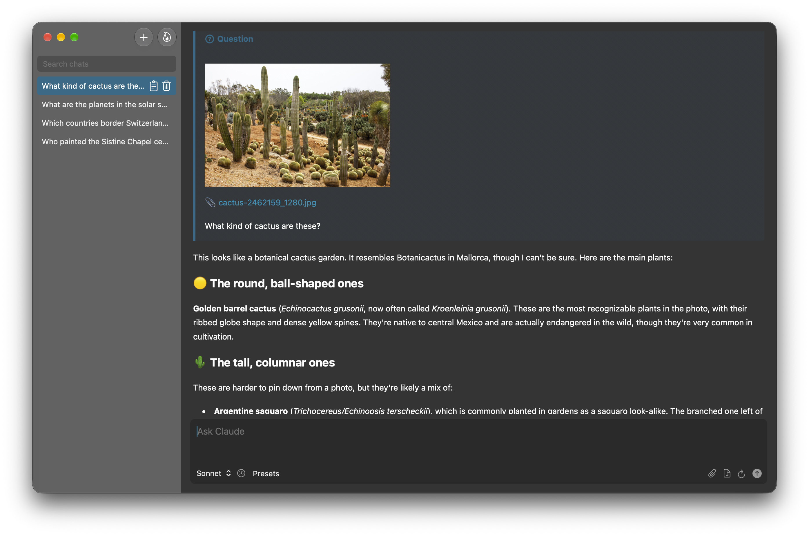
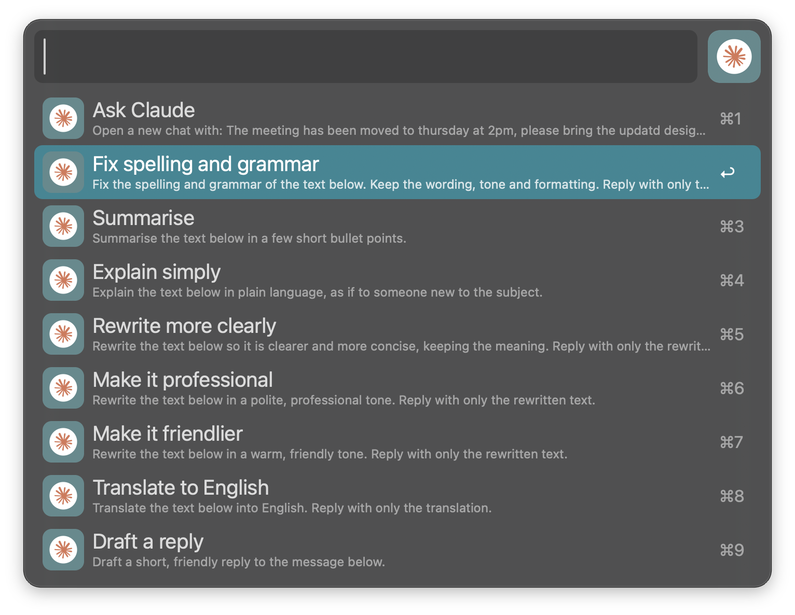
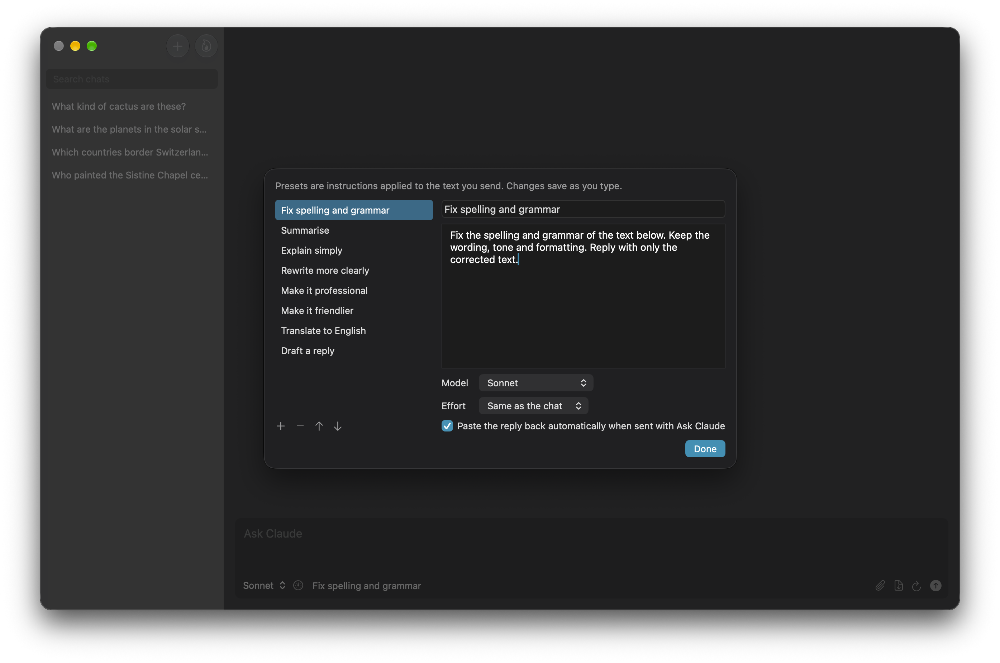

#  Claude Chat Alfred Workflow

Chat with Claude from Alfred, using your Claude plan or an API key

[⤓ Download the latest release](../../releases/latest)

Claude Chat is a chat window for [Alfred](https://www.alfredapp.com) that communicates with Claude via [Claude Code](https://claude.com/claude-code) running on your Mac. It is based on [Brain Outsourcing](https://github.com/alfredapp/brain-outsourcing-workflow) by the Alfred team, with the engine switched from an HTTP API call to Claude Code's headless mode.

## Requirements

* Alfred 6 with the Powerpack
* [Claude Code](https://claude.com/claude-code) installed on your Mac

The workflow never downloads or installs anything. It runs the copy of Claude Code you already have.

## Setup

1. Install Claude Code, then run `claude` once in Terminal and log in with your Claude account.
2. Download the workflow from the [releases page](../../releases/latest) and double-click it to install.

That is all most people need. The rest is optional and lives in the [Workflow’s Configuration](https://www.alfredapp.com/help/workflows/user-configuration/).

| Setting | What it does |
| ------- | ------------ |
| `Claude Path` | Leave empty and the workflow finds Claude Code by itself. Set a path only if it isn't found. |
| `API Key` | Leave empty to use the Claude account you're logged in to in Claude Code. Set a Claude API key to pay per use through the [Claude Console](https://platform.claude.com) instead. |
| `Model` | The model new chats start with. |
| `Custom Instructions` | Standing instructions for every chat, such as "Use Australian English" or "Keep answers short". They are added to the workflow's own instructions and take effect from the next message. |
| `Chat Keyword` | The keyword that opens the chat window. Defaults to `claude`. |
| `External` | Open the chat in a separate window rather than inside Alfred. |
| `Fallback Context` | How many earlier messages to resend if a chat's Claude Code session can no longer be found. |
| `Timeout` | Seconds of silence before giving up on a reply. |

### Finding Claude Code

With `Claude Path` empty, the workflow checks the usual install locations in this order: the native installer (`~/.local/bin`), Homebrew, the older `~/.claude/local` install, then npm, bun, Volta, pnpm, Yarn, mise, asdf, MacPorts, Nix, and nvm and fnm Node versions. If none of those match, it asks your login shell.

If it still can't find Claude Code, run `which claude` in Terminal and paste the result into `Claude Path`.

### Claude plan or API key

By default, messages count against the usage limits of the Claude plan you're logged in to, just like using Claude Code in Terminal. Any `ANTHROPIC_API_KEY` already set in your environment is ignored, so the workflow can't accidentally switch you to paid API use.

To pay per use instead, paste a key into `API Key`. Claude Code still needs to be installed, but you don't need to log in. The key is stored in the workflow's configuration and is omitted when you export the workflow.

## Usage

Open the chat window with the `claude` keyword, or set a [Hotkey](https://www.alfredapp.com/help/workflows/triggers/hotkey/) for faster triggering. Type text after the keyword to start a new chat with it.



* <kbd>↩</kbd> sends your message. While Claude is answering, the send button becomes a stop button.
* The regenerate button next to it asks the last question again and replaces the reply. Change the model or the effort first to get a second opinion.
* The paperclip attaches files to your next message. See [Attachments](#attachments).
* The paste button puts the last reply into the app you came from. See [Ask Claude from anywhere](#ask-claude-from-anywhere).
* The search box above the chat list filters chats as you type.
* Each chat in the sidebar has buttons to copy the last message and to delete the chat. Right-click a chat for the same actions, and to copy or export the whole chat as Markdown. Exporting asks where to save the file.
* The model dropdown in the chat window switches model. You can change it between messages in the same chat.
* The gauge next to the model dropdown sets the effort: how hard Claude thinks before answering. See [Effort](#effort).

Each chat keeps its own Claude Code session, so follow-up questions see the whole conversation as real turns rather than a pasted transcript.

### Effort

Claude thinks before answering when a question needs it. Effort sets how much: higher levels think for longer and get hard questions right more often, lower ones answer sooner. Choose a level from the gauge next to the model dropdown, or press <kbd>⌘</kbd><kbd>T</kbd>.

* `Low` suits quick rewrites, spelling fixes and short answers.
* `Medium` and `High` suit everyday questions and ones that take some working out.
* `Extra High` and `Max` are for hard problems, such as maths, logic or tricky code. Max can think for half a minute or more.
* `Default` leaves it to Claude Code. When a level is set there, with Claude Code's `/effort` command, the menu shows which, such as Default (High).

The level applies to every chat until you change it. To try a reply again more carefully, raise the effort and press <kbd>⌘</kbd><kbd>R</kbd>.

While Claude thinks, the chat shows Thinking… with the seconds counting up. Claude Code doesn't pass on the thinking itself, so the time is all the window can show.

### Ask Claude from anywhere

Select text or files in any app and run the `Ask Claude` [Universal Action](https://www.alfredapp.com/help/features/universal-actions/), or set the workflow's second Hotkey to send the current selection.



Pick a preset and the chat window opens with the answer on its way. Pick `Ask Claude` to open a new chat with the text in the message box, or the files attached, ready for your own question. This works whether the chat window is already open or not.

When the reply is what you wanted, press <kbd>⌘</kbd><kbd>⇧</kbd><kbd>↩</kbd>. The chat window closes and the reply is pasted into the app you came from, replacing the text you had selected. So fixing the spelling of a paragraph is: select it, Ask Claude, Fix spelling and grammar, <kbd>⌘</kbd><kbd>⇧</kbd><kbd>↩</kbd>. The reply is also left on your clipboard.

### Presets

A preset is a saved instruction, such as Fix spelling and grammar or Summarise, that is applied to the text you send. The workflow comes with eight.

In the chat window, choose one from the Presets menu. The button shows its name, and your next message is sent with it. After the reply, the button goes back to Presets, so follow-up messages are plain ones.

To add, change, reorder or delete presets, choose Edit Presets… from the same menu.

Each preset has three options in the editor:

* `Model` answers with a particular model whenever the preset is used, such as Haiku for quick spelling fixes. Leave it on Same as the chat to use the model chosen in the chat window.
* `Effort` sets how hard Claude thinks for the preset, such as Low for spelling fixes and High for Explain simply. Leave it on Same as the chat to use the level chosen in the chat window.
* `Paste the reply back automatically` skips the last step when the preset is used through `Ask Claude`: as soon as Claude has answered, the chat window closes and the reply replaces the text you had selected. It suits presets that return only the finished text. If the reply isn't what you wanted, undo in the app you pasted into.



### Attachments

Send up to 10 files with a message:

* Click the paperclip to choose files.
* Press <kbd>⌘</kbd><kbd>⇧</kbd><kbd>V</kbd> to attach what is on the clipboard: a screenshot, files copied in Finder, or copied text.
* Run `Ask Claude` on files in Finder or Alfred.

The names of attached files appear next to the paperclip. Click them to remove one or all. In the chat, images are shown above your question, and each file's name is a link that opens it.

| File | How Claude gets it |
| ---- | ------------------ |
| Images, including HEIC, TIFF and BMP | As images |
| PDF, up to 20 MB | As a PDF |
| Pages, Numbers and Keynote | As the PDF preview stored inside the file |
| Word, RTF, OpenDocument and HTML | Converted to text |
| Excel (`.xlsx`) | Each sheet as a table of values. Formulas give their last result |
| PowerPoint (`.pptx`) | The text of each slide |
| Any text file, such as code, Markdown, CSV or logs | As text |
| Zip archives, up to 50 MB unpacked | Unpacked for Claude to look inside |

Audio, video and other files Claude can't read are refused with a message saying why.

### Shortcuts

| Shortcut | Action |
| -------- | ------ |
| <kbd>⌘</kbd><kbd>N</kbd> | New chat |
| <kbd>⌘</kbd><kbd>F</kbd> | Search chats |
| <kbd>⌘</kbd><kbd>P</kbd> | Presets menu |
| <kbd>⌘</kbd><kbd>T</kbd> | Effort menu |
| <kbd>⌘</kbd><kbd>R</kbd> | Regenerate the last reply |
| <kbd>⌘</kbd><kbd>⇧</kbd><kbd>C</kbd> | Copy the last reply |
| <kbd>⌘</kbd><kbd>⇧</kbd><kbd>↩</kbd> | Paste the last reply into the app you came from, and close |
| <kbd>⌘</kbd><kbd>⇧</kbd><kbd>V</kbd> | Attach what is on the clipboard |
| <kbd>⌘</kbd><kbd>E</kbd> | Export the open chat as Markdown |
| <kbd>⌘</kbd><kbd>]</kbd> or <kbd>⌥</kbd><kbd>⌘</kbd><kbd>↓</kbd> | Next chat |
| <kbd>⌘</kbd><kbd>[</kbd> or <kbd>⌥</kbd><kbd>⌘</kbd><kbd>↑</kbd> | Previous chat |
| <kbd>⌘</kbd><kbd>⇧</kbd><kbd>⌫</kbd> | Delete all chats. They go to the Trash. |

## Good to know

* Claude has no tools in this window: no shell, no web, and no access to your files beyond what you attach. Your MCP servers are not started for these chats.
* Text files over 200 KB and zip archives are too big to send whole. In a chat with one of those, Claude gets read-only tools limited to the workflow's attachments folder, and reads or searches the file itself.
* Attachments are copied into the workflow's data folder and go to the Trash with their chat.
* Pasting a reply back works by the chat window asking Alfred to press <kbd>⌘</kbd><kbd>V</kbd> through the workflow's `paste_reply` External Trigger. The trigger checks a one-time token, so opening its link from anywhere else does nothing.
* Replies take a second or two longer to start than a direct API call because Claude Code launches for each message. The window shows "Starting Claude…" and then "Thinking…" while you wait.
* The first time Alfred launches Claude Code, macOS may ask whether it can read the Claude login from your Keychain. Choose Always Allow.
* Claude Code saves each chat as a session under `~/.claude/projects`. Deleting a chat in the workflow does not delete that session.
* Regenerating a reply starts a new Claude Code session for that chat when the old one can't be rewound. Earlier messages are sent along as context.
* Presets are saved in the workflow's data folder, so they survive workflow updates. Delete All Chats leaves them alone.

## Building from source

The `Workflow` folder is the workflow itself. To package it:

```sh
cd Workflow && zip -r "../Claude Chat.alfredworkflow" . -x '.*'
```

## Credits and licence

Based on [Brain Outsourcing](https://github.com/alfredapp/brain-outsourcing-workflow), copyright Running with Crayons Ltd. Released under the [BSD 3-Clause licence](LICENSE).

This is an independent project and is not affiliated with or endorsed by Anthropic or Running with Crayons Ltd.
