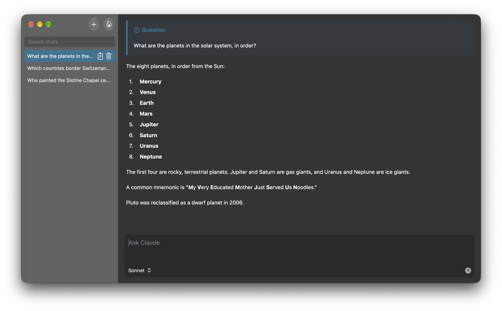

#  Claude Chat Alfred Workflow

Chat with Claude from Alfred, using your Claude plan or an API key

[⤓ Download the latest release](../../releases/latest)

Claude Chat is a chat window for [Alfred](https://www.alfredapp.com) that communicates with Claude via [Claude Code](https://claude.com/claude-code) running on your Mac. It is based on [Brain Outsourcing](https://github.com/alfredapp/brain-outsourcing-workflow) by the Alfred team, with the engine switched from an HTTP API call to Claude Code's headless mode.

## Requirements

* Alfred 6 with the Powerpack
* [Claude Code](https://claude.com/claude-code) installed on your Mac

The workflow never downloads or installs anything. It runs the copy of Claude Code you already have.

## Setup

1. Install Claude Code, then run `claude` once in Terminal and log in with your Claude account.
2. Download the workflow from the [releases page](../../releases/latest) and double-click it to install.

That is all most people need. The rest is optional and lives in the [Workflow’s Configuration](https://www.alfredapp.com/help/workflows/user-configuration/).

| Setting | What it does |
| ------- | ------------ |
| `Claude Path` | Leave empty and the workflow finds Claude Code by itself. Set a path only if it isn't found. |
| `API Key` | Leave empty to use the Claude account you're logged in to in Claude Code. Set a Claude API key to pay per use through the [Claude Console](https://platform.claude.com) instead. |
| `Model` | The model new chats start with. |
| `Chat Keyword` | The keyword that opens the chat window. Defaults to `claude`. |
| `External` | Open the chat in a separate window rather than inside Alfred. |
| `Fallback Context` | How many earlier messages to resend if a chat's Claude Code session can no longer be found. |
| `Timeout` | Seconds of silence before giving up on a reply. |

### Finding Claude Code

With `Claude Path` empty, the workflow checks the usual install locations in this order: the native installer (`~/.local/bin`), Homebrew, the older `~/.claude/local` install, then npm, bun, Volta, pnpm, Yarn, mise, asdf, MacPorts, Nix, and nvm and fnm Node versions. If none of those match, it asks your login shell.

If it still can't find Claude Code, run `which claude` in Terminal and paste the result into `Claude Path`.

### Claude plan or API key

By default, messages count against the usage limits of the Claude plan you're logged in to, just like using Claude Code in Terminal. Any `ANTHROPIC_API_KEY` already set in your environment is ignored, so the workflow can't accidentally switch you to paid API use.

To pay per use instead, paste a key into `API Key`. Claude Code still needs to be installed, but you don't need to log in. The key is stored in the workflow's configuration and is omitted when you export the workflow.

## Usage

Open the chat window with the `claude` keyword, or set a [Hotkey](https://www.alfredapp.com/help/workflows/triggers/hotkey/) for faster triggering.



* <kbd>↩</kbd> sends your message. While Claude is answering, the send button becomes a stop button.
* The search box above the chat list filters chats as you type.
* Each chat in the sidebar has buttons to copy the last message and to delete the chat. Right-click a chat for the same actions.
* The model dropdown in the chat window switches model. You can change it between messages in the same chat.

| Shortcut | Action |
| -------- | ------ |
| <kbd>⌘</kbd><kbd>N</kbd> | New chat |
| <kbd>⌘</kbd><kbd>F</kbd> | Search chats |
| <kbd>⌘</kbd><kbd>]</kbd> or <kbd>⌥</kbd><kbd>⌘</kbd><kbd>↓</kbd> | Next chat |
| <kbd>⌘</kbd><kbd>[</kbd> or <kbd>⌥</kbd><kbd>⌘</kbd><kbd>↑</kbd> | Previous chat |
| <kbd>⌘</kbd><kbd>⇧</kbd><kbd>⌫</kbd> | Delete all chats. They go to the Trash. |

Each chat keeps its own Claude Code session, so follow-up questions see the whole conversation as real turns rather than a pasted transcript.

## Good to know

* Claude has no tools in this window: no file access, no shell, and no web. Your MCP servers are not started for these chats.
* Replies take a second or two longer to start than a direct API call because Claude Code launches for each message. The window shows "Starting Claude…" and then "Thinking…" while you wait.
* The first time Alfred launches Claude Code, macOS may ask whether it can read the Claude login from your Keychain. Choose Always Allow.
* Claude Code saves each chat as a session under `~/.claude/projects`. Deleting a chat in the workflow does not delete that session.

## Building from source

The `Workflow` folder is the workflow itself. To package it:

```sh
cd Workflow && zip -r "../Claude Chat.alfredworkflow" . -x '.*'
```

## Credits and licence

Based on [Brain Outsourcing](https://github.com/alfredapp/brain-outsourcing-workflow), copyright Running with Crayons Ltd. Released under the [BSD 3-Clause licence](LICENSE).

This is an independent project and is not affiliated with or endorsed by Anthropic or Running with Crayons Ltd.
